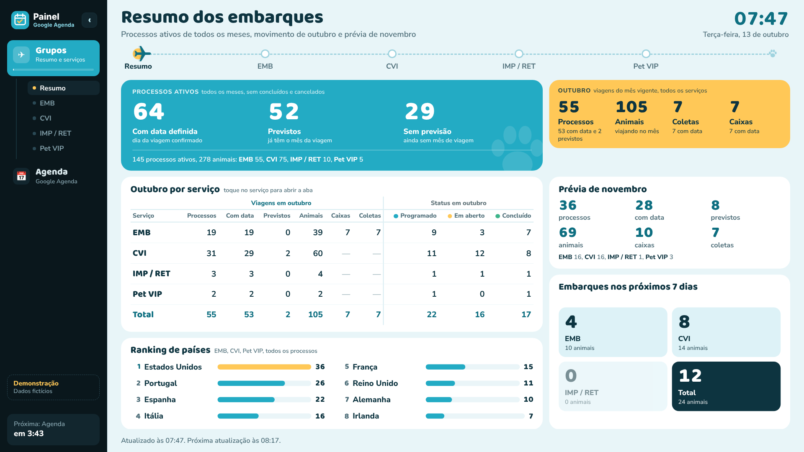
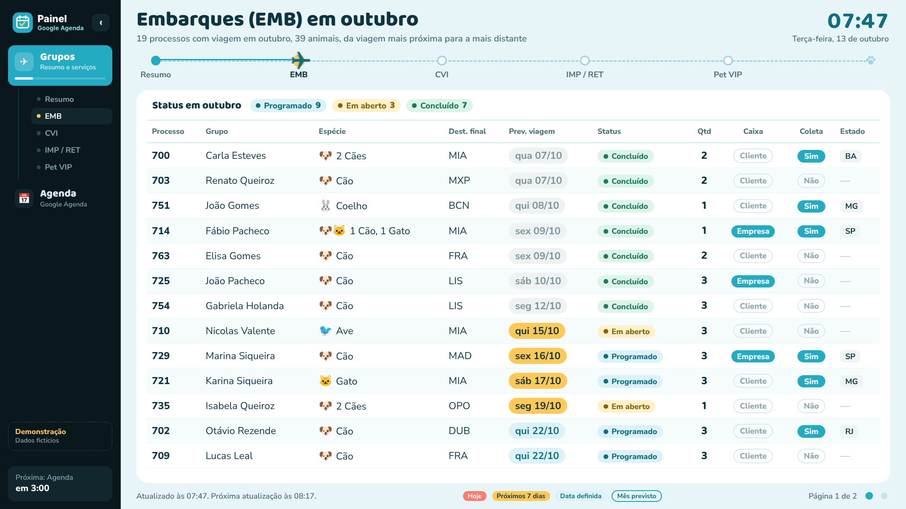
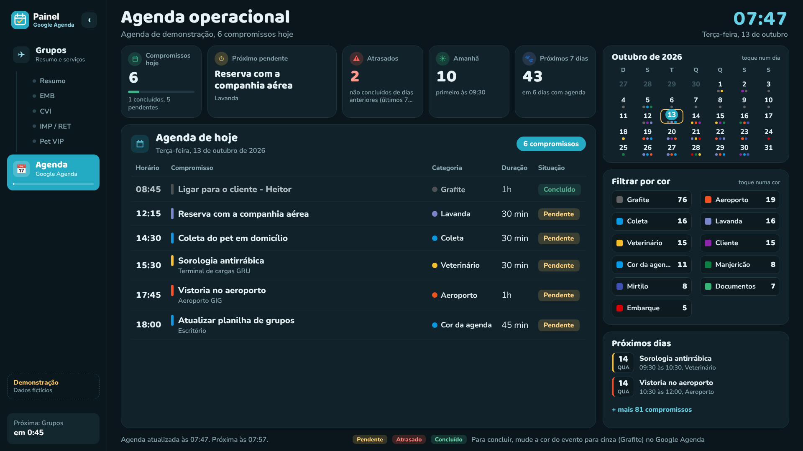
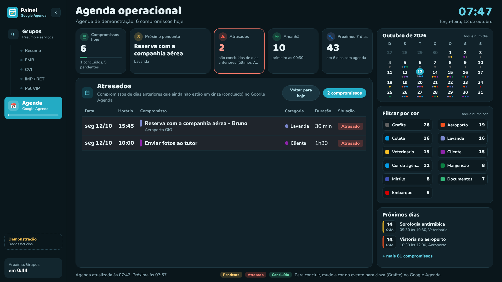

# Painel Google Agenda

Painel para TV que junta, em uma única tela, uma **planilha de processos** do Google Planilhas e a **agenda da equipe** no Google Agenda. Ele roda como Web App do Google Apps Script e fica passando sozinho, em looping, entre as seções.

**Demonstração ao vivo (dados fictícios):** https://edniltonbernardo63.github.io/painel-google-agenda/



## O que ele mostra

**Grupos** (lidos da planilha, uma tela para cada aba)

- **Resumo:** processos ativos (com data, previstos e sem previsão), o mês vigente por serviço com caixas, coletas e status, uma prévia do próximo mês, um ranking de países e os embarques dos próximos 7 dias.
- **EMB, CVI, IMP / RET e Pet VIP:** as viagens do mês vigente, com faixa de status e paginação automática.

**Agenda** (Google Agenda)

- A agenda do dia mostra cada compromisso como **Pendente** (amarelo), **Atrasado** (vermelho) ou **Concluído** (verde).
- Um compromisso está concluído quando o evento está **cinza (Grafite)** no Google Agenda.
- O horário não importa: o compromisso fica pendente o dia todo e só vira atrasado quando o dia passa.
- Cartões no topo: compromissos de hoje, próximo pendente, atrasados, amanhã e próximos 7 dias.
- Calendário do mês clicável e filtro por cor.

**Funcionamento**

- Menu lateral recolhível, com a contagem para a próxima seção.
- Cada tela fica 3 minutos. Ao terminar Grupos, abre a Agenda e depois volta, em looping.
- A planilha é relida a cada 30 minutos e a agenda a cada 10 minutos, sem recarregar a página.
- O layout se ajusta ao tamanho da tela. Em telas pequenas aparece uma barra de rolagem.

| Serviço | Agenda | Atrasados |
|---|---|---|
|  |  |  |

## Como apresentar (demonstração)

A demonstração **não precisa de conta Google**. Os dados são inventados e gerados a partir da data de hoje, então ela está sempre "em dia".

1. Abra o link da demonstração em qualquer navegador (computador, TV ou celular).
2. Aperte **F11** para tela cheia.
3. Use o menu lateral para alternar entre **Grupos** e **Agenda**. Os pontos da rota do avião, os dias do calendário, as cores do filtro e o cartão **Atrasados** também são clicáveis.
4. As setas **← →** do teclado avançam ou voltam as telas.

Parâmetros opcionais no endereço:

| Endereço | O que faz |
|---|---|
| `.../painel-google-agenda/?tempo=20` | cada tela fica 20 segundos (o padrão da demonstração é 45) |
| `.../painel-google-agenda/?secao=agenda` | abre direto na Agenda |
| `.../painel-google-agenda/?tempo=20&secao=agenda` | os dois juntos |

Para apresentar sem internet: baixe o repositório (**Code > Download ZIP**), descompacte e abra o arquivo `index.html` no navegador.

## Como instalar com dados reais

1. Crie uma planilha com as abas **EMB**, **CVI**, **IMP / RET** e **PET VIP**. Os cabeçalhos ficam na pasta [`modelo/`](modelo). A primeira linha pode ter um título; o painel encontra a linha de cabeçalho pela coluna **PROCESSO**.
2. Na planilha, abra **Extensões > Apps Script**.
3. Copie o conteúdo de [`apps-script/Codigo.gs`](apps-script/Codigo.gs) para o arquivo de código. Crie um arquivo HTML chamado **Index** e cole [`apps-script/Index.html`](apps-script/Index.html).
4. Em **Configurações do projeto**, marque "Mostrar arquivo de manifesto" e cole [`apps-script/appsscript.json`](apps-script/appsscript.json). Confira o fuso horário (America/Sao_Paulo).
5. No bloco `CONFIG` do `Codigo.gs`, ajuste:
   - `SPREADSHEET_ID`: deixe vazio se o script foi criado dentro da planilha.
   - `AGENDA.CALENDARIO_ID`: o e-mail da agenda. Vazio usa a agenda da própria conta. Se for a agenda de outra conta, ela precisa estar compartilhada com "Ver todos os detalhes dos eventos".
   - `AGENDA.NOMES_CORES`: o significado de cada cor (opcional), por exemplo `{ 'Tomate': 'Embarque' }`.
6. Selecione a função **`testarLeitura`**, clique em **Executar** e autorize. O registro mostra o que foi lido.
7. Vá em **Implantar > Nova implantação > App da Web**, escolha **Executar como: Eu** e abra o link gerado na TV.

Depois de qualquer alteração: **Implantar > Gerenciar implantações > ✏️ > Nova versão**.

## Estrutura

```
index.html                  página da demonstração (GitHub Pages)
demo/servidor-demo.js       cópia de apps-script/Codigo.gs usada pela demonstração
demo/dados-ficticios.js     simula a planilha, o Google Agenda e o google.script.run
apps-script/                arquivos para instalar no Google Apps Script
modelo/                     cabeçalhos das abas da planilha, com exemplos fictícios
assets/                     logo (texto escuro e texto branco)
docs/                       prints usados neste README
```

Ao alterar `apps-script/Codigo.gs`, copie o mesmo conteúdo para `demo/servidor-demo.js` para a demonstração acompanhar.

---

Todos os nomes, processos e compromissos da demonstração são fictícios.
